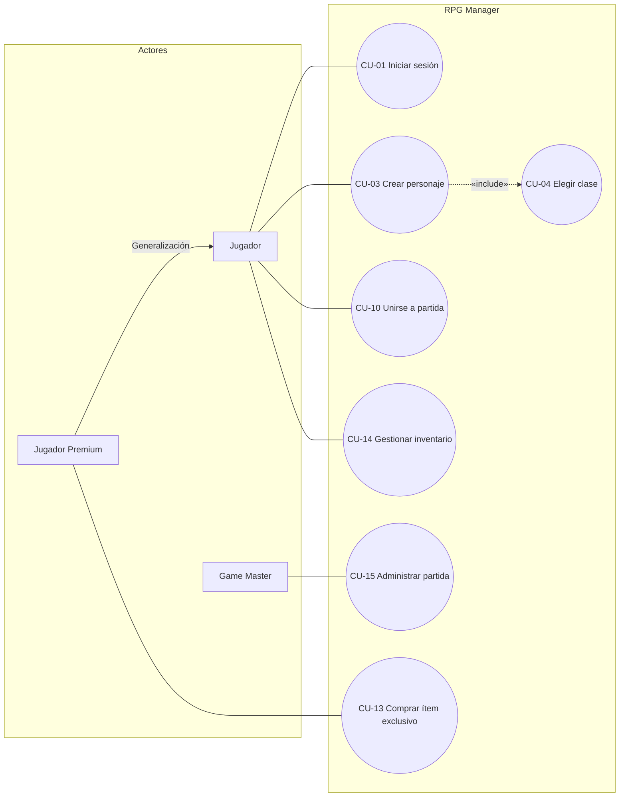

##    Ejercicio 1A: Completa los flujos que faltan

El sistema todavía tiene dos flujos sin dibujar. Se escriben en la tabla y se agregan al diagrama:

1. Cuando el Jugador inicia sesión, ¿qué dato envía?
2. Cuando el Servicio de Respaldo devuelve una partida guardada, ¿qué dato viaja y en qué dirección?

| #   | Origen                          | Flujo de datos                                              | Destino      |
|-----|---------------------------------|-------------------------------------------------------------|--------------|
| F10 | Jugador                         | credenciales de acceso (usuario/correo y contraseña)        | RPG Manager  |
| F11 | Servicio de Respaldo en la Nube | copia de partida guardada (datos de la partida recuperada)  | RPG Manager  |

### Justificación

- **F10:** el Jugador es quien inicia sesión, por lo que es el origen. Envía sus credenciales al RPG Manager, que las recibe para validarlas contra los datos que ya tiene guardados.
- **F11:** el Servicio de Respaldo devuelve la partida guardada, por lo que el flujo sale del servicio externo y llega al RPG Manager. Es el sentido contrario de F9, donde el RPG Manager enviaba la copia de seguridad a la nube.

##  Bug a corregir

Un compañero entregó un diagrama de contexto con estos elementos. Se identifican los tres errores:

- Un rectángulo "Base de datos de Personajes" conectado al círculo como entidad externa.
- Una flecha de Jugador al círculo con la etiqueta "Crear Personaje".
- Una flecha directa de Jugador a Game Master con la etiqueta "mensaje".

| #       | Elemento                                              | Error                                                                 | Corrección                                                                                          |
|---------|-------------------------------------------------------|-----------------------------------------------------------------------|-----------------------------------------------------------------------------------------------------|
| Error 1 | Rectángulo "Base de datos de Personajes" como entidad externa | Una base de datos es un almacén de datos interno del sistema, no una entidad externa. En un diagrama de contexto no se dibujan almacenes. | Eliminarla del diagrama de contexto. Aparecería después, como almacén, en el DFD de nivel 1. |
| Error 2 | Flecha "Crear Personaje"                              | La etiqueta es un verbo (una acción o proceso), no un dato. Los flujos deben nombrar los datos que viajan. | Renombrarla como **"datos del personaje (nombre, clase)"** (F2). |
| Error 3 | Flecha directa Jugador → Game Master "mensaje"        | Un flujo entre dos entidades externas queda fuera del sistema. Todo flujo debe entrar o salir del proceso central. | Eliminar la flecha, o hacer que el mensaje pase por el RPG Manager (Jugador → RPG Manager → Game Master). |

### Respuestas

- **Error 1:** La "Base de datos de Personajes" es un almacén de datos interno, no una entidad externa, y no debe aparecer en un diagrama de contexto.
- **Error 2:** "Crear Personaje" es una acción, no un dato. El flujo debe llamarse "datos del personaje (nombre, clase)".
- **Error 3:** La flecha Jugador → Game Master conecta dos entidades externas entre sí. Todo flujo debe pasar por el sistema (RPG Manager).

# EJERCICIO 2A: Generalización de Actores

## Respuestas a las preguntas

**1. ¿Hacia dónde apunta el triángulo vacío y por qué?**

Respuesta: Apunta hacia el actor Jugador (el actor padre o general). En UML, la flecha de generalización con punta de triángulo hueco señala desde el elemento hijo (específico) hacia el elemento padre (general), indicando la relación de herencia.

**2. ¿Por qué el Jugador Premium NO necesita líneas a CU-01 … CU-10?**

Respuesta: Porque gracias a la generalización, el Jugador Premium hereda automáticamente todas las relaciones y asociaciones a los casos de uso que ya posee el actor Jugador. Trazar líneas repetidas hacia los mismos casos de uso sería redundante en UML.

## BUG A CORREGIR: Identificación de errores

| # | Error identificado | Descripción y solución |
|---|---|---|
| 1 | Uso de "Inventario" como Caso de Uso | Un caso de uso representa una acción, por lo que debe nombrarse con un verbo en infinitivo (ej. CU-14 Gestionar inventario), no como un sustantivo. |
| 2 | Actor Game Master dentro del sistema | Los actores representan entidades externas al sistema. Todos los actores deben graficarse fuera del rectángulo del límite del sistema. |
| 3 | Dirección invertida en la relación «include» | La inclusión apuntaba de CU-04 a CU-03. Debe apuntar siempre del caso de uso base al caso de uso incluido (CU-03 Crear personaje → CU-04 Elegir clase). |
| 4 | Asociación directa entre Jugador y Game Master | En UML, los actores nunca se conectan directamente entre sí. La comunicación debe realizarse a través de los casos de uso del sistema. |

## Diagrama de Casos de Uso (Mermaid UML)

## Resumen de reglas de diagramación aplicadas

- **Actores fuera del límite:** Los actores se ubican fuera del recuadro principal del sistema.
- **Asociaciones:** Representadas mediante líneas continuas sin flechas entre actor y caso de uso.
- **Estereotipo Include:** Representado por una línea punteada orientada desde el caso de uso base (CU-03) hacia el caso de uso incluido (CU-04).
- **Herencia:** El Jugador Premium conserva el acceso a todas las funcionalidades del Jugador base más su caso de uso exclusivo (CU-13).
